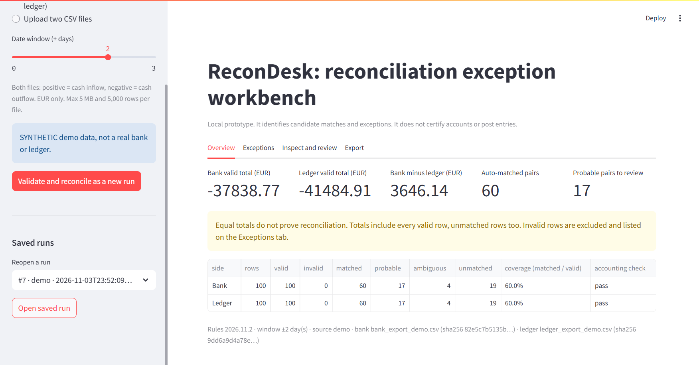
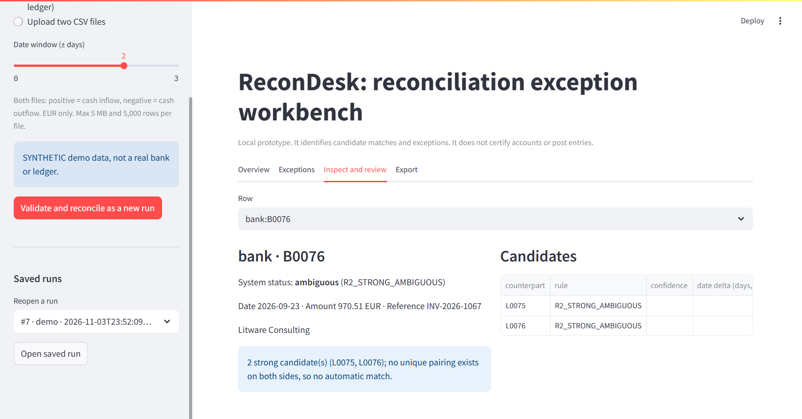

# ReconDesk

**Match a bank export against a cash ledger. Auto-match only what can be proven, propose the near-misses, and show a reviewer the evidence for everything else.**




## Why

Every month a finance team has to show that the bank statement and the company's own cash ledger agree. Matching the easy lines is tedious, and the hard lines are where the mistakes hide. ReconDesk does the provable part automatically and puts every exception in front of a person with the reason attached. It never guesses quietly.

It is a local prototype for a portfolio demo: it does not certify accounts, post journal entries or connect to a bank.

## Features

- **Exact matches are automatic.** Same reference, same amount, dates within a window, and the only possible partner on both sides.
- **Near-misses are proposed, never applied.** Reference typos, missing references, small fees and late postings get a high or medium confidence label and one-click confirmation.
- **Same answer in any row order.** Ambiguity is checked across all candidates before anything is matched.
- **Exact money.** Amounts are integer cents parsed from text. No floats, no silent rounding, no dropped rows.
- **Traceable reviews.** Decisions are stored as events next to the original files and their fingerprints. Reopening a run recomputes and verifies the results.
- **Safe exports.** Results and review history as CSV, with spreadsheet-formula text neutralised.

## Quick start

Requires Python 3.11 or newer.

**Windows (PowerShell)**

```powershell
git clone https://github.com/DeeptiTeragunti/recondesk.git
cd recondesk
./start.ps1
```

**macOS / Linux** (not tested yet)

```bash
git clone https://github.com/DeeptiTeragunti/recondesk.git
cd recondesk
python3 -m venv .venv && source .venv/bin/activate
pip install -r requirements.lock.txt
streamlit run app.py --server.address 127.0.0.1
```

Open http://127.0.0.1:8501. Installing packages needs internet; the app itself makes no network calls.

## Usage

1. In the sidebar, pick **Synthetic demo** (bundled) or upload your own two CSV files.
2. Click **Validate and reconcile as a new run**.
3. Check **Overview** for totals and the accounting check, then filter **Exceptions** by status.
4. In **Inspect and review**, read the evidence, confirm a candidate or write a review note.
5. Download the results and review history from **Export**.



Your own files need these columns: `transaction_id, date (YYYY-MM-DD), amount, currency (EUR), reference, description`. Positive amounts are money in, negative are money out.

## How matching works

| Status | When | Applied automatically? |
|---|---|---|
| **matched** | Reference, amount and date (±2 days) agree, and the pair is unique on both sides | Yes |
| **probable** | One near-miss: reference typo or missing, fee within max(2 EUR, 1%), or up to 5 days late; still unique | No, one-click review |
| **ambiguous** | More than one exact candidate | No |
| **unmatched** | A conflict, a weak suggestion, or nothing at all | No |
| **invalid** | The row failed validation | Excluded and listed |

Every row carries its rule ID and a plain-English evidence sentence. Confidence labels are rule scores, not probabilities.

## Results

| Data | Automatic matches | Wrong | Probable proposals | Wrong |
|---|---:|---:|---:|---:|
| Synthetic demo (100 rows each side) | 60 | 0 | 17 | 5 |
| Real bank data, account 8261 (675 rows) vs derived ledger (690 rows) | 406 | 0 | 148 | 0 |

The second ledger is generated from the real bank rows, so the right answers are known in advance. These numbers show the rules behave as designed. They are not real-world accuracy. Full measurements with denominators are in [docs/EVAL_REPORT.md](docs/EVAL_REPORT.md) and [docs/DETAILS.md](docs/DETAILS.md#real-bank-data-pkdd99-czech-bank-dataset-berka).

## Tech stack

Python · Streamlit · SQLite (standard library) · pytest. Two direct runtime dependencies, pinned in `requirements.lock.txt`.

## Project structure

```
app.py              Streamlit UI
reconcile/          core: ingest, matcher, review, store, service, exporter, evaluation
scripts/            demo generator, evaluation, bank converters (Berka, Open Bank Project), ledger generator
tests/              pytest suite
data/demo/          synthetic bank and ledger CSVs with a truth manifest
docs/               details, evaluation report, screenshots
```

## Running tests

```bash
python -m pytest -q
```

102 tests cover money parsing, validation, every matching rule, review constraints, persistence, export safety, evaluation and the data pipelines.

## Optional: real bank data

The **Real bank data** option uses the public PKDD'99 Czech bank dataset (Berka). It is not included here; rebuild it locally (about 68 MB download):

```powershell
mkdir data/private/berka
curl.exe -L -o data/private/berka/trans.asc https://raw.githubusercontent.com/ldaniel/fgv-exploratory-data-analysis/master/data/trans.asc
.venv\Scripts\python.exe -m scripts.berka_bank --out data/berka/bank_berka.csv
.venv\Scripts\python.exe -m scripts.derive_ledger --bank data/berka/bank_berka.csv --out-dir data/berka --seed 7
```

Amounts are converted from CZK to EUR at a fixed, illustrative rate. Details, and the Open Bank Project sandbox option, are in [docs/DETAILS.md](docs/DETAILS.md).

## Limitations

- Batched deposits, split payments, currency conversion and netted fees are not matched; they are left for manual review.
- Single user, no login. `local-user` is a label, and the review log is not tamper-proof.
- One fixed CSV format. No PDFs, no column mapping.
- No live AI. Explanations are generated from the rules.

## Documentation

- [docs/DETAILS.md](docs/DETAILS.md): input contract, every rule, architecture, data pipelines, verification
- [DEMO_SCRIPT.md](DEMO_SCRIPT.md): a three-minute walkthrough
- [PLAN.md](PLAN.md): milestones and design decisions

## Acknowledgements

- PKDD'99 Discovery Challenge financial dataset, prepared by Petr Berka and Marta Sochorová.
- [Open Bank Project](https://www.openbankproject.com/) API sandbox.

## Author

**Deepti Teragunti** · [GitHub](https://github.com/DeeptiTeragunti)
